# JHONDRIVER — proposta de interface

Interface publicada na versão **0.8.0**. Capturas reais do aplicativo em emulador Android 13, com dados de exemplo. Atualize em Configurações → Verificar atualização, sem desinstalar.

O acabamento da tela de Amigos foi estendido ao painel, configurações, histórico, metas, etiquetas, suporte e entrada. Cabeçalho compacto, cartões consistentes e navegação com ícones vetoriais. Os temas claro e escuro mantêm as mesmas funções.

## Painel no celular

| Claro | Escuro |
| --- | --- |
| 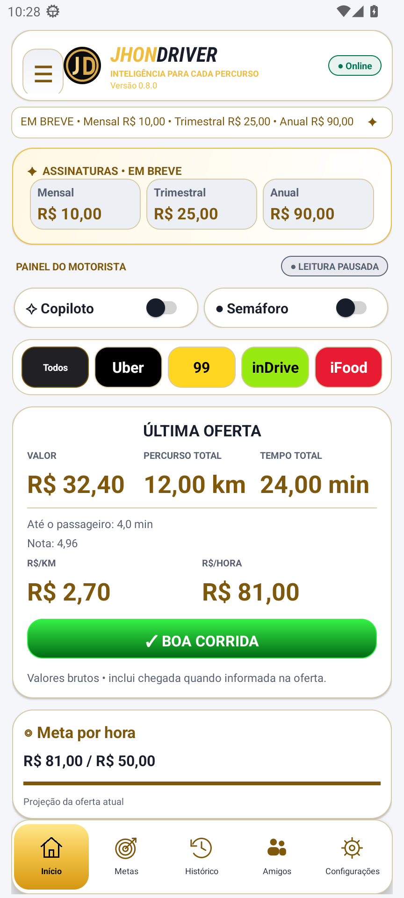 | 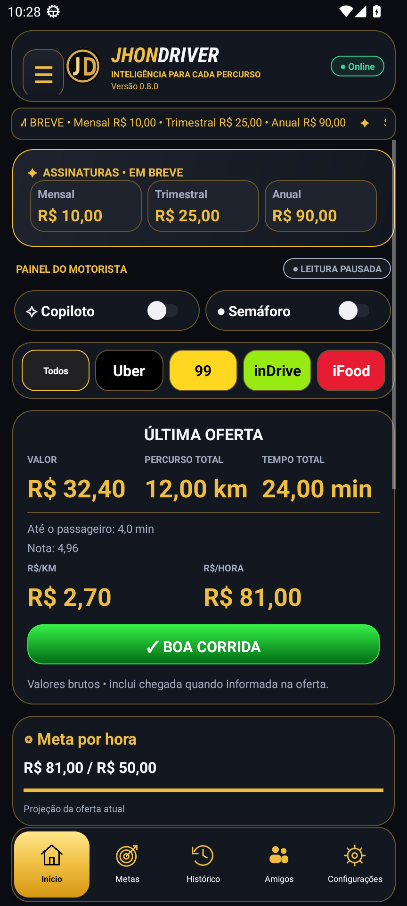 |

## Painel no tablet

| Claro | Escuro |
| --- | --- |
| 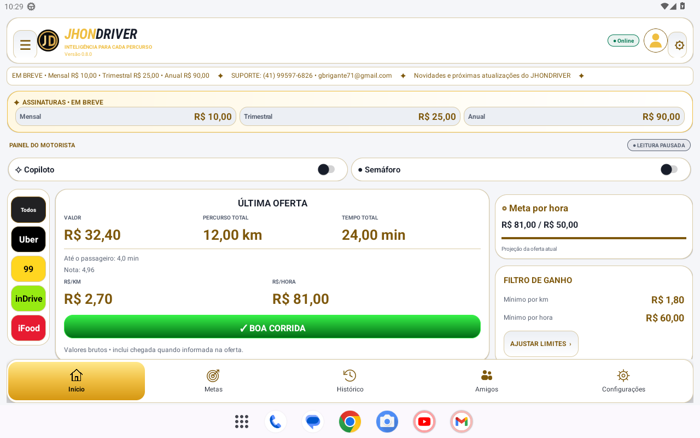 | 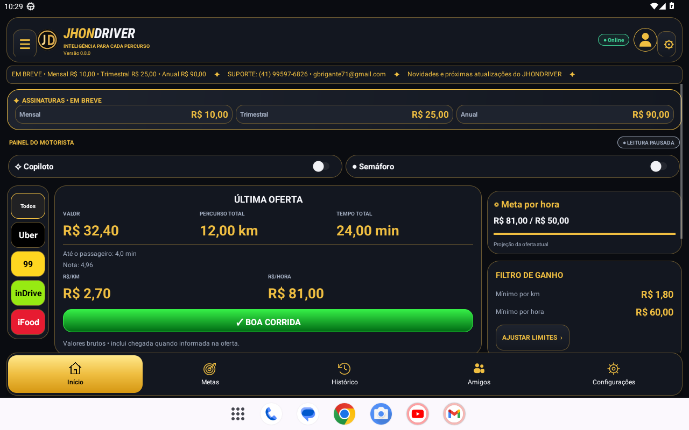 |

## Configurações

| Claro | Escuro |
| --- | --- |
|  |  |

## Histórico de ofertas

| Claro | Escuro |
| --- | --- |
| 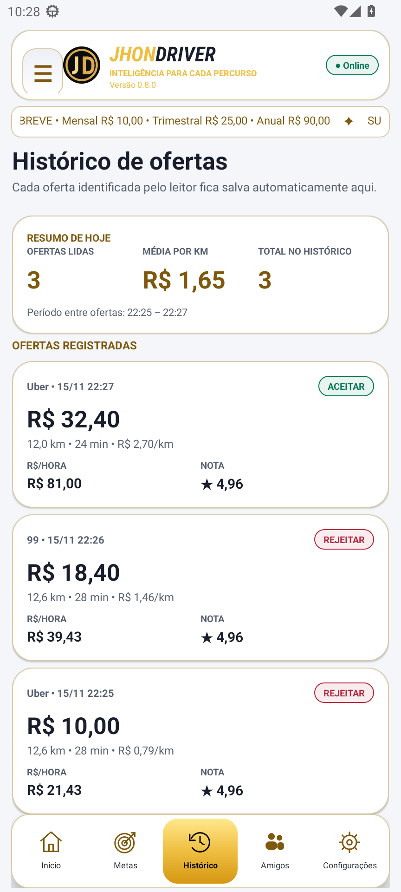 | 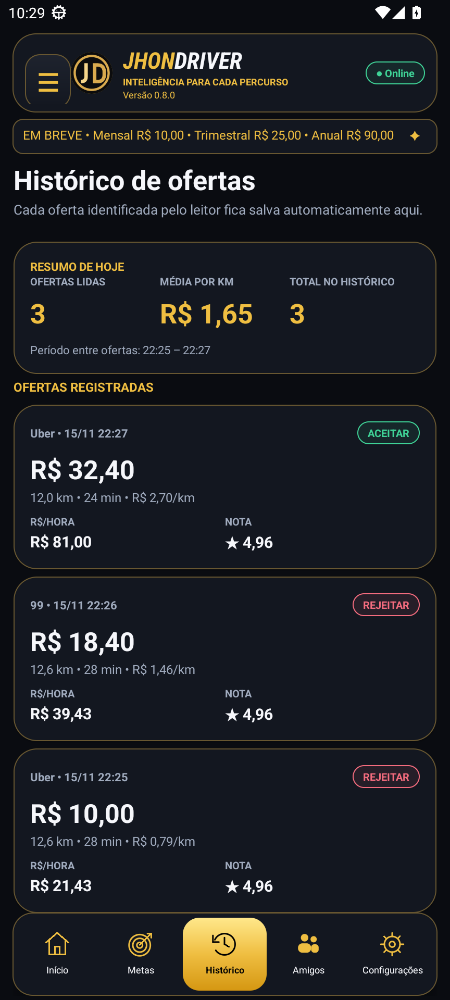 |

## Metas e faixas

| Claro | Escuro |
| --- | --- |
|  |  |

## Personalização da etiqueta

| Claro | Escuro |
| --- | --- |
|  |  |

## Amigos

| Claro | Escuro |
| --- | --- |
| 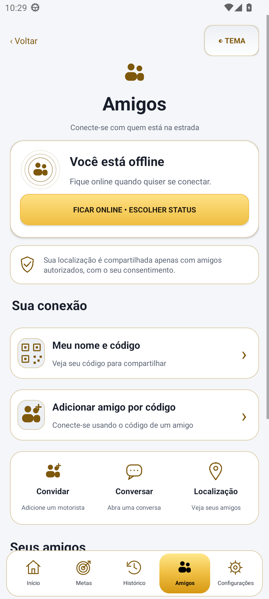 | 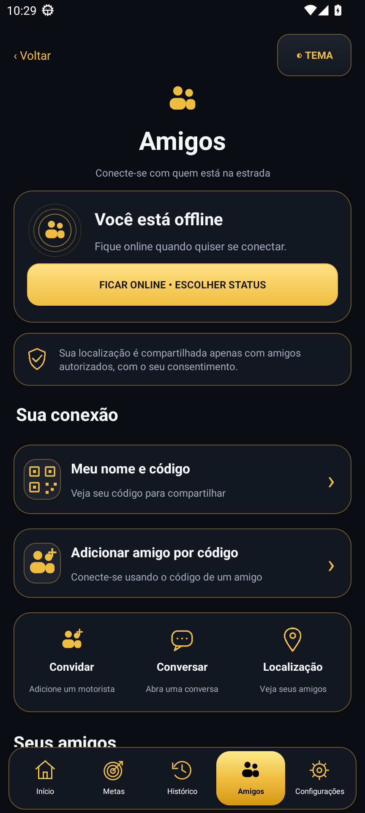 |

## Ajuda e suporte

| Claro | Escuro |
| --- | --- |
|  | 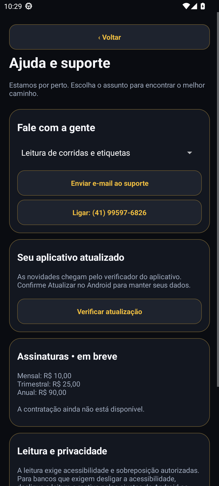 |

## Entrada

| Claro | Escuro |
| --- | --- |
| 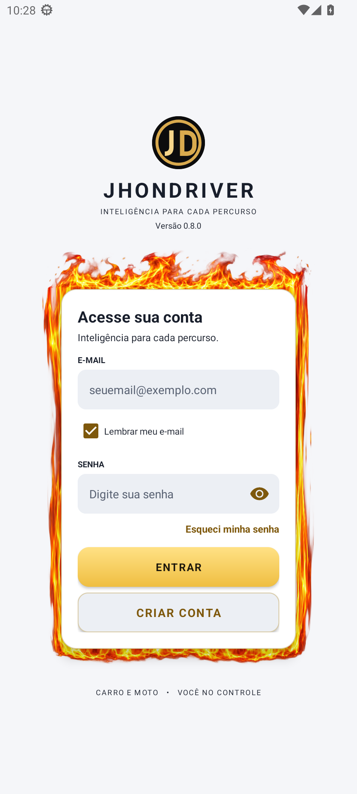 |  |

## Conversa no tablet

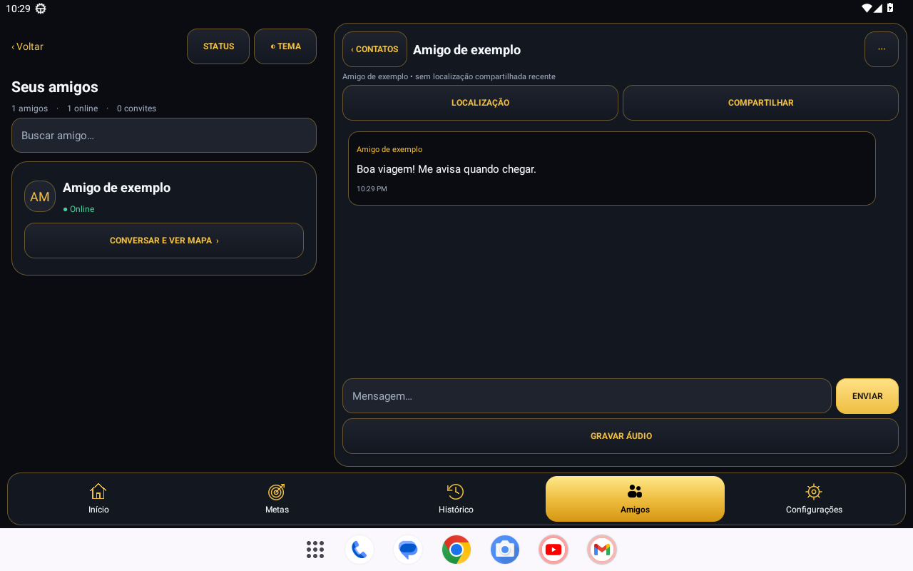

Validação: compilação, testes unitários e regressões de interface/privacidade/chat/áudio aprovados no Android 13 e 16. Verificação adicional mantém a classificação da corrida e o atalho de ajustar limites totalmente visíveis no tablet de teste.
